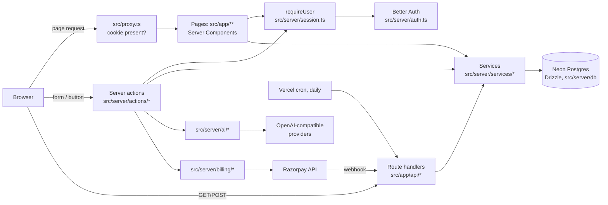
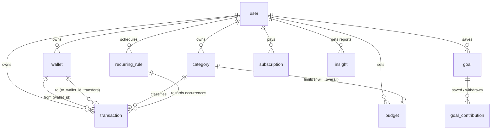

# Architecture

How the system is put together today. Why it's this way is in
[design-decisions.md](design-decisions.md); rules the code must keep are in
[business-rules.md](business-rules.md). Verified against the code on 2026-10-26 (independent audit).

## What the app is

ClearPaisa is a budget tracker for people new to managing money. Signed-in
users keep wallets (cash, bank, credit card), record entries (spending, income,
transfers), set monthly budgets, save towards goals, track recurring bills and
subscriptions, and can ask an AI about their own data. A Free/Pro plan with
Razorpay exists but is switched off (`BILLING_ENABLED`). An `/admin` page shows
usage stats to the owner.

## System overview

## Layers and where code belongs

| Layer                      | Folder                                  | Holds                                                                                                                      | May import                                                                                  |
| -------------------------- | --------------------------------------- | -------------------------------------------------------------------------------------------------------------------------- | ------------------------------------------------------------------------------------------- |
| Routes                     | `src/app/`                              | pages, layouts, error/not-found pages, route handlers                                                                      | everything below                                                                            |
| UI                         | `src/components/`                       | `ui/` shadcn primitives (generated, don't hand-edit), `ui-extra/` shared form pieces, `app/` shell, one folder per feature | `lib/`, `config/`, server actions (as RPC)                                                  |
| Server actions             | `src/server/actions/`                   | the app's API: `requireUser()`, validate with Zod, call a service, `refresh()`                                             | services, `lib/`, `config/` (account, settings and billing also query `db/` directly: debt) |
| Data access + domain logic | `src/server/services/`                  | most queries, filtered by `userId`; ownership checks (`getOwned*`); `UserError` for expected failures                      | `db/`, `lib/`, `config/`                                                                    |
| Integrations               | `src/server/ai/`, `src/server/billing/` | AI providers, quotas, fallback; Razorpay calls, webhooks, plan resolution                                                  | services, `db/`                                                                             |
| Shared logic               | `src/lib/`                              | pure helpers used by client and server: money, dates, validation schemas, budget/goal/recurring maths                      | `config/` only (no server code)                                                             |
| Settings                   | `src/config/`                           | app name, plans, limits, feature switches, legal details                                                                   | nothing app-specific                                                                        |
| Database                   | `src/server/db/`                        | `schema.ts` (the source of truth), pool, migration runner, signup seeding                                                  | —                                                                                           |

Modules that hold secrets or read the session (`env.ts`, `auth.ts`,
`session.ts`, `admin.ts`, `action-utils.ts`, `db/index.ts`, `ai/index.ts`,
`ai/access.ts`, `billing/razorpay.ts`, `recurring-sync.ts`) start with
`import "server-only"` (a stub in tests); services don't, and are reached only
through those. `tests/security/static.test.ts` checks files marked
`"use client"`: they may import server actions, but nothing else from
`@/server/`, nor `@/env`, the database or `node:` built-ins. Server Components
may import server code (e.g. `src/components/app/user-menu.tsx`).

## Request flow

1. `src/proxy.ts` sends visitors without a session cookie to `/` (public pages
   are listed there). It only checks the cookie exists.
2. The page renders a static shell, prerendered at build time. Anything
   user-specific is an async component under `<Suspense>` that streams in.
3. That component calls `requireUser()`, which verifies the session through
   Better Auth (once per request, React `cache`) and redirects to
   `/?signed-out=1` if there's none, then calls services with `(db, userId, …)`.
4. A change is a server action: `requireUser()` → parse with Zod (shared
   schemas in `src/lib/validation.ts`) → service → `refresh()` (from
   `next/cache`) → result.
5. The client calls it through `callAction()` or a form via `useFormAction()`;
   the result (or "didn't go through") is shown in place.

## Server and Client Components

- Pages and layouts are Server Components. They read data directly from
  services; there is no client-side data fetching library.
- `"use client"` only where there's interaction: forms, dialogs, menus,
  charts with hover, the chat. They receive plain data as props.
- Forms: `useFormAction(action, initial)` from
  `src/components/ui-extra/use-form-action.ts`, spread onto `<form {...form}>`.
  Not `<form action>` directly: React 19 resets the fields after every submit.
- Other calls: `callAction(() => someAction(...))` from `src/lib/call-action.ts`,
  usually inside `startTransition`. It returns `NOT_SENT` when the request
  failed and re-throws Next's redirect/not-found signals.
- Optimistic UI: `useOptimistic` in the AI switch and the alert list, reverted automatically on failure.
- Filters live in the URL (`transaction-filters.tsx` uses `router.replace`).
- One React context: the entry dialog (`entry-dialog.tsx`), so "Add entry"
  works from anywhere.

## Contracts and error handling

- **Server action results:** `ActionResult` in `src/server/action-utils.ts`:
  `{ ok: true }`, or `{ ok: false, fieldErrors }` for Zod errors (first message
  per field), or `{ ok: false, error }` for a `UserError`. `runAction()` does the
  mapping; any other error is re-thrown (a real bug, or Next's redirect).
  Some actions return their own typed result (`ChatReply`, `CheckoutStart`,
  `ParseResult`, …): see each file.
- **Expected failures** throw `UserError(message, field?)`
  (`src/server/services/errors.ts`); the message is shown to the user as is.
- **Route handlers** (all under `src/app/api/`):

| Route                         | Who may call                             | Responses                                          |
| ----------------------------- | ---------------------------------------- | -------------------------------------------------- |
| `GET/POST /api/auth/*`        | Better Auth (sign-in, session, sign-out) | Better Auth's                                      |
| `GET /api/health`             | anyone                                   | `{ok:true}` 200 or `{ok:false}` 503, `no-store`    |
| `GET /api/export`             | the signed-in user                       | CSV of their entries, or 401                       |
| `GET /api/cron/recurring`     | scheduler with `Bearer CRON_SECRET`      | 503 unset, 401 wrong, 200 `{users, recorded}`      |
| `POST /api/webhooks/razorpay` | Razorpay (HMAC signature)                | 503 off, 400 bad signature/payload, 502 retry, 200 |

- **Error pages:** `src/app/error.tsx` and `src/app/(app)/error.tsx` (props
  `{ error, retry }`) show the error's digest as a reference; `global-error.tsx`
  is a plain last resort without it. `not-found.tsx` at the root and in `(app)`.
- **Logging:** `console.error/warn` with a `[area]` prefix and `err.message`
  only; never secrets or request bodies.

## Data model

All money columns are `bigint` minor units, all calendar dates `date` strings.
Every user-owned table has `user_id` with `on delete cascade`, except
`ai_usage`, whose per-user rows are keyed by `scope = "user:<id>"` and removed
by `deleteAccountData` (`src/server/services/account.ts`).

Also: `merchant_rule` (learned description → category), `alert_dismissal`,
`ai_usage` (daily counters per user, provider and globally), `payment_event`
(webhook ids, for idempotency), and Better Auth's `session`, `account`,
`verification`. Schema: `src/server/db/schema.ts`; migrations: `drizzle/`.

## External services

| Service                        | Used for                        | Code                                      | Settings                                |
| ------------------------------ | ------------------------------- | ----------------------------------------- | --------------------------------------- |
| Neon Postgres                  | everything stored               | `src/server/db/`                          | `DATABASE_URL`, `DATABASE_URL_UNPOOLED` |
| Google OAuth (via Better Auth) | sign-in                         | `src/server/auth.ts`                      | `BETTER_AUTH_*`, `GOOGLE_*`             |
| Groq / Cerebras / OpenRouter   | AI features, optional           | `src/server/ai/`                          | `LLM_*`, `AI_GLOBAL_DAILY_LIMIT`        |
| Razorpay                       | Pro subscriptions, switched off | `src/server/billing/`                     | `BILLING_ENABLED`, `RAZORPAY_*`         |
| Vercel                         | hosting, daily cron             | `vercel.json`, `scripts/vercel-build.mjs` | project settings                        |
| GitHub Actions                 | CI, nightly encrypted backup    | `.github/workflows/`                      | repo secrets                            |

## Feature map

| Feature                  | Page                       | Components               | Actions                            | Logic                                                                                           | Tests (besides security/)                                                                     |
| ------------------------ | -------------------------- | ------------------------ | ---------------------------------- | ----------------------------------------------------------------------------------------------- | --------------------------------------------------------------------------------------------- |
| Entries                  | `(app)/transactions`       | `transactions/`          | `transactions.ts`, `entry-form.ts` | `services/transactions.ts`                                                                      | `db/wallets-transactions`, `e2e/smoke`                                                        |
| Wallets, transfers       | `(app)/wallets`            | `wallets/`               | `wallets.ts`                       | `services/wallets.ts`, `lib/wallets.ts`                                                         | `db/wallets-transactions`, `component/wallet-form`                                            |
| Categories               | `(app)/categories`         | `categories/`            | `categories.ts`                    | `services/categories.ts`, `lib/default-categories.ts`                                           | `db/category-order`, `db/seed-defaults`                                                       |
| Budgets, alerts          | `(app)/budgets`, dashboard | `budgets/`, `dashboard/` | `budgets.ts`, `alerts.ts`          | `services/budgets.ts`, `alerts.ts`, `reports.ts`, `lib/budgets.ts`                              | `unit/budgets-goals`, `db/budgets-goals`, `e2e/budgets-goals`                                 |
| Goals                    | `(app)/goals`              | `goals/`                 | `goals.ts`                         | `services/goals.ts`, `lib/goals.ts`                                                             | same as budgets                                                                               |
| Recurring, subscriptions | `(app)/recurring`          | `recurring/`             | `recurring.ts`                     | `services/recurring.ts`, `lib/recurring.ts`, `lib/subscriptions.ts`, `server/recurring-sync.ts` | `unit/recurring`, `db/recurring`, `e2e/recurring`                                             |
| AI entry and categories  | entry dialog               | `transactions/`          | `ai.ts`                            | `server/ai/index.ts`, `parse-entry.ts`, `categorize.ts`                                         | `unit/ai`, `db/ai`                                                                            |
| Money chat               | `(app)/ask`                | `ask/`                   | `chat.ts`                          | `server/ai/chat.ts`, `quota.ts`                                                                 | `db/chat-tools`, `component/chat-panel`, `e2e/ai`                                             |
| Onboarding               | `/welcome`, `/setup`       | `setup/`                 | `settings.ts`, `setup.ts`          | `services/setup.ts`, `lib/setup-plan.ts`, `server/ai/setup.ts`                                  | `db/setup`, `unit/setup-plan`, `e2e/setup`                                                    |
| Insights                 | `(app)/insights`           | `insights/`              | `insights.ts`                      | `services/insight-facts.ts`, `insights.ts`, `server/ai/insights.ts`                             | `unit/insights`, `db/insights`, `e2e/billing`                                                 |
| Plans, billing           | `(app)/billing`            | `billing/`               | `billing.ts`                       | `server/billing/*`, `api/webhooks/razorpay`                                                     | `unit/billing`, `db/billing`, `integration/`                                                  |
| Settings, export, delete | `(app)/settings`           | `settings/`              | `settings.ts`, `account.ts`        | `services/account.ts`, `api/export`                                                             | `db/account`, `unit/account`, `integration/routes`, `component/delete-account`, `e2e/account` |
| Admin                    | `(app)/admin`              | —                        | —                                  | `server/admin.ts`, `services/admin-stats.ts`                                                    | `e2e/account`                                                                                 |
| Legal pages              | `(legal)/*`                | `legal/`                 | —                                  | `config/legal.ts`                                                                               | `e2e/account`                                                                                 |

Page, Components and Actions paths are relative to `src/app/`,
`src/components/` and `src/server/actions/`. In Logic, `services/…` is under
`src/server/`, `api/…` under `src/app/`, and the rest under `src/`. Tests are
under `tests/`.

## Tracing a feature

1. Find the page in `src/app/` (route groups in parentheses don't appear in the URL).
2. Follow its imports to the components and, for changes, the server action they call.
3. In the action, note the schema from `src/lib/validation.ts` and the service it calls.
4. In the service, the query and its `userId` scoping; the table in `schema.ts`.
5. Find the tests: `grep -rln "<functionName>" tests`.
